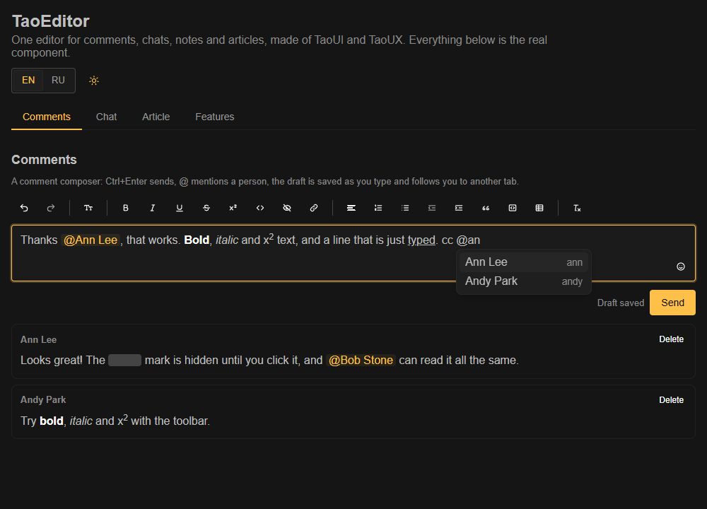
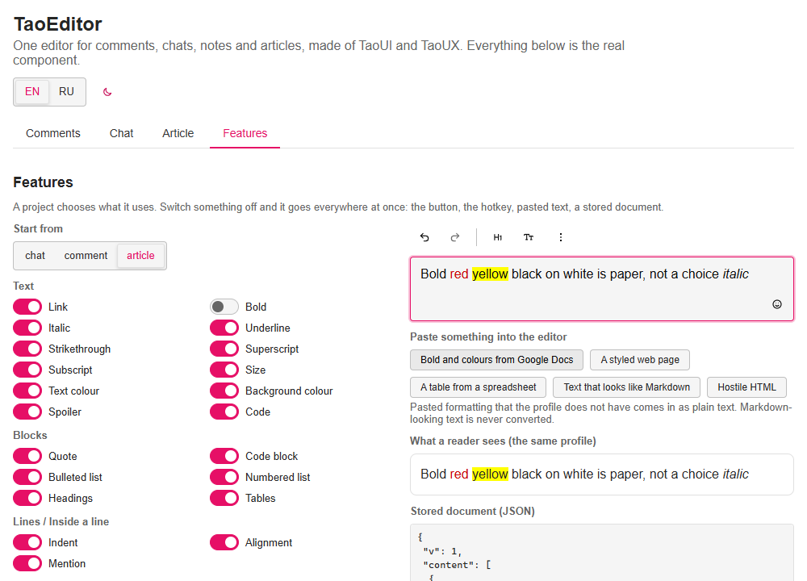

# TaoEditor

<p align="center">
  
  
</p>

**English** · [Русский](README.ru.md)

An embeddable rich-text editor for comments, chat messages, notes and articles, built to sit in the TaoUI / TaoUX family. One document model and one set of rules for all of them; a project chooses what it uses, and the choice holds everywhere at once: the toolbar, the hotkeys, pasted text, a stored document.

**Stack:** TypeScript 6, Vue 3 (optional), [ProseMirror](https://prosemirror.net) as the editing engine (eight small MIT packages, exact versions), [TaoUI](https://www.npmjs.com/package/@1337exp/taoui) for the toolbar, ESM only. The document, the allowlists, the link policy and the viewer are ours, so the engine stays replaceable without touching what is stored.

```bash
npm install
npm run demo         # the demo page, http://localhost:5197/ (add -- --host to open it from a phone)
npm run dev          # the lab: the engine with its event log and a corpus of pastes
npm test             # core, engine, viewer and component tests
npm run typecheck
npm run build        # the library and its declarations
npm run mutate       # break the code on a copy, one thing at a time, and check that the tests notice
npm run screenshot   # docs/media/*.png for this README, needs Chrome or Edge
```

## Use

```bash
npm install @1337exp/taoeditor @1337exp/taoui vue
```

```ts
import '@1337exp/taoui/styles.css';
import 'prosemirror-view/style/prosemirror.css';
import '@1337exp/taoeditor/content.css';
import '@1337exp/taoeditor/editor.css';
import '@1337exp/taoeditor/taoui.css'; // the bridge: the editor follows the TaoUI theme
```

```vue
<script setup lang="ts">
import { withoutFeatures } from '@1337exp/taoeditor/core';
import { TaoEditorView } from '@1337exp/taoeditor/vue';
import { TaoEditor } from '@1337exp/taoeditor/vue/taoui';

// a project chooses what it uses: no bold, no alignment
const profile = withoutFeatures('comment', { marks: ['bold'], features: ['align'] });
</script>

<template>
    <TaoEditor v-model="doc" :profile="profile" submit="mod-enter" emoji :mentions="findPeople" @send="post" />
    <TaoEditorView :doc="saved" :profile="profile" class="tao-prose" @mention="openProfile" />
</template>
```

On a server (previews, e-mails, search) use `@1337exp/taoeditor/core`: `normalizeDoc`, `toHtml`, `toPlainText`. Without TaoUI use `/core` and `/editor` with your own toolbar; the look comes from `--te-*` variables with neutral defaults.

## What it does

- **Own stored document**: a versioned JSON tree (`{ v: 1, content: [...] }`). No HTML is ever stored, and the engine's own JSON is never the format.
- **A normalizer is the gate**: untrusted JSON in, a canonical valid document out, never throws. Unknown or forbidden nodes are unwrapped (the text survives), links go through one allowlist (`https`/`http`, no credentials), control characters are stripped, nesting is capped.
- **Choose what the project uses.** Ready profiles `chat`, `comment`, `article` (colours and subscript are for the article; a comment has the superscript, a chat does not); make your own with `withoutFeatures(...)` or `defineProfile(...)`. What a profile leaves out has no button, its hotkey does nothing, pasted formatting that has it comes in as plain text, and a stored document is shown without it. A typo in a name throws.
- **The bar of a mail client**: undo and redo, bold, italic, underline, strikethrough, superscript and subscript, code, spoiler, link, text size, text and background colour (a grid of 80 and a field for any other), alignment, numbered and bulleted lists, quote, code block, tables, indents, paragraph style (normal text, Heading 1 to 3), clear formatting. Gmail and Docs hotkeys. Fixed or `floating` over the selection. The buttons a profile cannot use are not shown.
- **Tables** (`comment` and `article`; `chat` has none): a size picker in the toolbar, then a menu for the table the caret is in (rows and columns above, below, before, after, delete; a header row; delete the table). Tab and Shift+Tab walk the cells and leave at the ends, so the keyboard is never trapped. A table is a plain rectangle: no merged cells (a pasted merge comes in as single cells), at most 50 rows by 20 columns, no table inside a table. A profile without tables shows a pasted table as text.
- **Nothing is converted behind your back.** What is typed or pasted stays what it was: text that looks like Markdown stays text. Formatting exists only when it was applied explicitly or came as real formatting in the pasted HTML (Google Docs, Word and Gmail runs are read, their black ink and white paper are not).
- **Safe paste and safe output**: Ctrl+Shift+V pastes only the text (like Gmail and Docs; no button on purpose); pasted HTML is read only through the schema's rules, so scripts, handlers, images and unsafe links cannot get in; the output never takes a string as markup, and a colour can put nothing but a colour into a style.
- **Mentions** (`@name`): one unit in the text with an `id` and the label shown at the time. The editor only notices `@query`; the list of people is the app's (`mentions` prop: a function that returns people, now or as a promise). It works with the keys and the mouse and is announced to screen readers. **The `id` is a claim, the app must check it.**
- **Chat and comments**: Enter or Ctrl+Enter sends, Shift+Enter breaks the line, an IME composition never sends; an emoji button (plain Unicode text); no gap between paragraphs by default (Enter is a line), a gap for articles (`spaced`).
- **A viewer** (`TaoEditorView`) that never loads the editing engine: spoilers open on click, mentions are buttons when the app listens. The same render runs on a server (`toHtml`).
- **Made for TaoUI, usable without it**: only files in `src/vue/taoui/` import TaoUI (a test guards the layers); `taoui.css` is the single file that names TaoUI tokens, and a test checks that every one of them exists in the installed TaoUI.

## How it is built

```
src/core       no DOM, runs on a server too: model, schema and profiles, normalizer, links, colours, render (tree and HTML)
src/editor     the ProseMirror layer: schema from core, keys, history, blocks, mentions, createEditor()
src/vue        TaoEditorView: the viewer, no TaoUI, no engine
src/vue/taoui  TaoEditor: the only place that imports TaoUI
src/styles     content.css, editor.css, taoui.css (the bridge)
demo/          the demo page; lab/ the engine's workbench; neither is part of the package
tests/         core (node), engine, viewer and component (jsdom), layers, the bridge
```

Imports are by subpath, there is no root entry: `@1337exp/taoeditor/core`, `/editor`, `/vue`, `/vue/taoui`, `/content.css`, `/editor.css`, `/taoui.css`. `vue` and `@1337exp/taoui` are optional peer dependencies.

The decisions, what is proven and what is not: [docs/architecture.ru.md](docs/architecture.ru.md) (Russian). The release notes: [CHANGELOG.md](CHANGELOG.md).

## Not yet

- Export to Markdown (`.md`) for taking notes out, when it is needed.
- Images, embeds; merged table cells and column widths; custom (picture) emoji.
- Checked only by hand in Chromium and by tests in jsdom: **IME on Android and iOS (and Japanese or Korean composition), touch devices, Firefox and Safari are not checked yet.**

## License

MIT, see [LICENSE](LICENSE). ProseMirror is MIT, © Marijn Haverbeke and contributors.

## Us

Homepage: [666.io](https://666.io). If you want to help, suggest an idea or just talk, come by.
