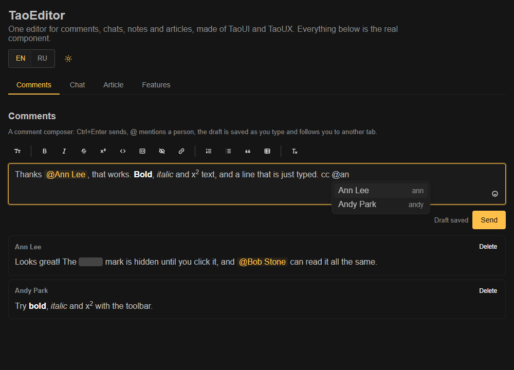
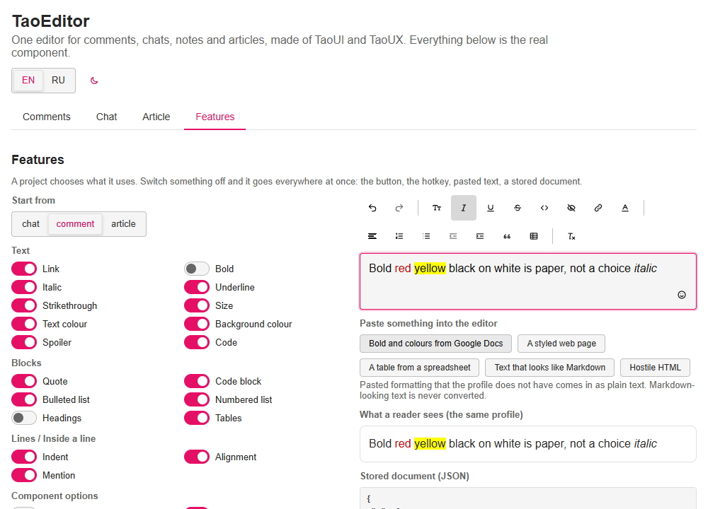

# TaoEditor

<p align="center">
  
  
</p>

[English](README.md) · **Русский**

Встраиваемый редактор для комментариев, сообщений чата, заметок и статей, сделанный для семейства TaoUI / TaoUX. Одна модель документа и один набор правил на всех; проект выбирает, чем пользуется, и выбор действует везде сразу: в панели, на горячих клавишах, при вставке текста, в сохранённом документе.

**Стек:** TypeScript 6, Vue 3 (по желанию), [ProseMirror](https://prosemirror.net) как движок редактирования (восемь маленьких MIT-пакетов, точные версии), [TaoUI](https://www.npmjs.com/package/@1337exp/taoui) для панели, только ESM. Документ, белые списки, политика ссылок и показ наши, поэтому движок можно заменить, не трогая то, что хранится.

```bash
npm install
npm run demo         # демо-страница, http://localhost:5197/ (добавьте -- --host, чтобы открыть с телефона)
npm run dev          # лаборатория: движок с журналом событий и набором вставок
npm test             # тесты ядра, движка, показа и компонента
npm run typecheck
npm run build        # библиотека и её декларации
npm run mutate       # ломаем код в копии по одной вещи и смотрим, что тесты замечают
npm run screenshot   # docs/media/*.png для этого README, нужен Chrome или Edge
```

## Как пользоваться

```bash
npm install @1337exp/taoeditor @1337exp/taoui vue
```

```ts
import '@1337exp/taoui/styles.css';
import 'prosemirror-view/style/prosemirror.css';
import '@1337exp/taoeditor/content.css';
import '@1337exp/taoeditor/editor.css';
import '@1337exp/taoeditor/taoui.css'; // мост: редактор следует теме TaoUI
```

```vue
<script setup lang="ts">
import { withoutFeatures } from '@1337exp/taoeditor/core';
import { TaoEditorView } from '@1337exp/taoeditor/vue';
import { TaoEditor } from '@1337exp/taoeditor/vue/taoui';

// проект выбирает, чем пользуется: без жирного и без выравнивания
const profile = withoutFeatures('comment', { marks: ['bold'], features: ['align'] });
</script>

<template>
    <TaoEditor v-model="doc" :profile="profile" submit="mod-enter" emoji :mentions="findPeople" @send="post" />
    <TaoEditorView :doc="saved" :profile="profile" class="tao-prose" @mention="openProfile" />
</template>
```

На сервере (превью, письма, поиск) берите `@1337exp/taoeditor/core`: `normalizeDoc`, `toHtml`, `toPlainText`. Без TaoUI берите `/core` и `/editor` со своей панелью; вид задают переменные `--te-*` с нейтральными значениями.

## Что умеет

- **Свой хранимый документ**: версионное JSON-дерево (`{ v: 1, content: [...] }`). HTML не хранится никогда, и JSON самого движка форматом не является.
- **Нормализатор — ворота**: на входе недоверенный JSON, на выходе канонический верный документ, исключений не бросает. Неизвестные и запрещённые узлы разворачиваются (текст сохраняется), ссылки идут через один список (`https`/`http`, без логина в адресе), управляющие символы удаляются, вложенность ограничена.
- **Проект выбирает, чем пользуется.** Готовые профили `chat`, `comment`, `article`; свой делается через `withoutFeatures(...)` или `defineProfile(...)`. Чего профиль не содержит, у того нет кнопки, не работает горячая клавиша, вставленное форматирование с этим приходит простым текстом, а сохранённый документ показывается без него. Опечатка в имени бросает ошибку.
- **Панель как у почтового клиента**: отмена и повтор, жирный, курсив, подчёркнутый, зачёркнутый, надстрочный и подстрочный, код, спойлер, ссылка, размер текста, цвет текста и фона (сетка на 80 и поле для любого другого), выравнивание, нумерованный и маркированный списки, цитата, таблицы, отступы, стиль абзаца (обычный текст, заголовки 1 до 3), очистка форматирования. Горячие клавиши Gmail и Docs. Обычная или `floating` над выделением. Кнопки, которые профилю не нужны, не показываются.
- **Таблицы** (`comment` и `article`; в `chat` их нет): выбор размера в панели, затем меню для таблицы, в которой стоит курсор (строки и столбцы выше, ниже, слева, справа, удаление; строка заголовка; удалить таблицу). Tab и Shift+Tab идут по ячейкам и в крайних отпускают, так что клавиатура не застревает. Таблица это простой прямоугольник: без объединённых ячеек (вставленное объединение приходит одиночными ячейками), не больше 50 строк на 20 столбцов, без таблицы в таблице. Профиль без таблиц показывает вставленную таблицу текстом.
- **Ничего не превращается за спиной.** Набранное и вставленное остаётся тем, чем было: текст, похожий на Markdown, остаётся текстом. Форматирование есть только если его применили явно или оно пришло настоящим форматированием во вставленном HTML (куски из Google Docs, Word и Gmail читаются, их чёрные чернила и белая бумага нет).
- **Безопасная вставка и безопасный вывод**: Ctrl+Shift+V вставляет только текст (как в Gmail и Docs; кнопки нет намеренно); вставленный HTML читается только правилами схемы, поэтому скрипты, обработчики, картинки и небезопасные ссылки не проходят; вывод никогда не принимает строку за разметку, а цвет не может внести в style ничего, кроме цвета.
- **Упоминания** (`@имя`): одна единица в тексте с `id` и подписью на момент вставки. Редактор лишь замечает `@запрос`; список людей принадлежит приложению (свойство `mentions`: функция, которая возвращает людей сразу или промисом). Работает с клавишами и мышью, озвучивается скринридеру. **`id` это заявление, приложение обязано его проверять.**
- **Чат и комментарии**: Enter или Ctrl+Enter отправляет, Shift+Enter переносит строку, композиция IME никогда не отправляет; кнопка эмодзи (обычный Юникод-текст); между абзацами по умолчанию нет зазора (Enter это строка), у статьи зазор есть (`spaced`).
- **Показ** (`TaoEditorView`), который не грузит движок редактирования: спойлеры открываются кликом, упоминания становятся кнопками, если приложение слушает. Тот же рендер работает на сервере (`toHtml`).
- **Сделан под TaoUI, работает и без него**: TaoUI импортируют только файлы в `src/vue/taoui/` (слои охраняет тест); `taoui.css` единственный файл, называющий токены TaoUI, и тест проверяет, что каждый из них есть в установленном TaoUI.

## Как устроено

```
src/core       без DOM, работает и на сервере: модель, схема и профили, нормализатор, ссылки, цвета, рендер (дерево и HTML)
src/editor     слой ProseMirror: схема из ядра, клавиши, история, блоки, упоминания, createEditor()
src/vue        TaoEditorView: показ, без TaoUI и без движка
src/vue/taoui  TaoEditor: единственное место, которое импортирует TaoUI
src/styles     content.css, editor.css, taoui.css (мост)
demo/          демо-страница; lab/ верстак движка; в пакет не входят ни то, ни другое
tests/         ядро (node), движок, показ и компонент (jsdom), слои, мост
```

Импорт по подпутям, корневого входа нет: `@1337exp/taoeditor/core`, `/editor`, `/vue`, `/vue/taoui`, `/content.css`, `/editor.css`, `/taoui.css`. `vue` и `@1337exp/taoui` — необязательные peer-зависимости.

Решения, что доказано и что нет: [docs/architecture.ru.md](docs/architecture.ru.md). История выпусков: [CHANGELOG.md](CHANGELOG.md).

## Пока нет

- Выгрузка в Markdown (`.md`), чтобы забирать заметки, когда понадобится.
- Картинки, вставки; объединённые ячейки и ширина столбцов в таблицах; кастомные эмодзи-картинки.
- Проверено только руками в Chromium и тестами в jsdom: **IME на Android и iOS (и японская или корейская композиция), сенсорные устройства, Firefox и Safari ещё не проверены.**

## Лицензия

MIT, см. [LICENSE](LICENSE). ProseMirror — MIT, © Marijn Haverbeke и участники.

## Мы

Домашняя страница: [666.io](https://666.io). Хочешь помочь, предложить идею или просто поговорить — заходи.
